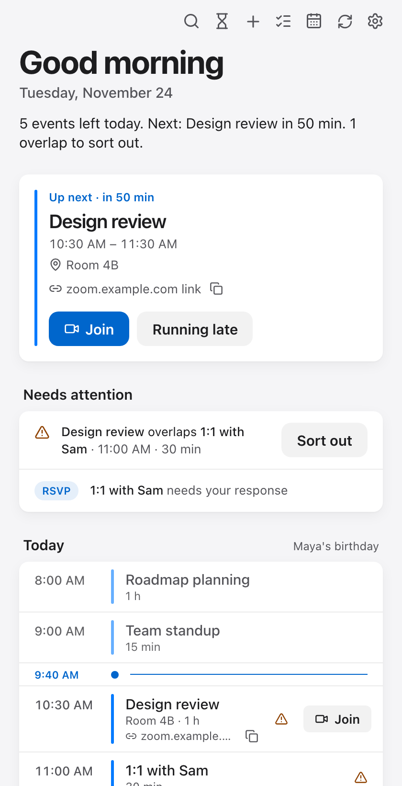
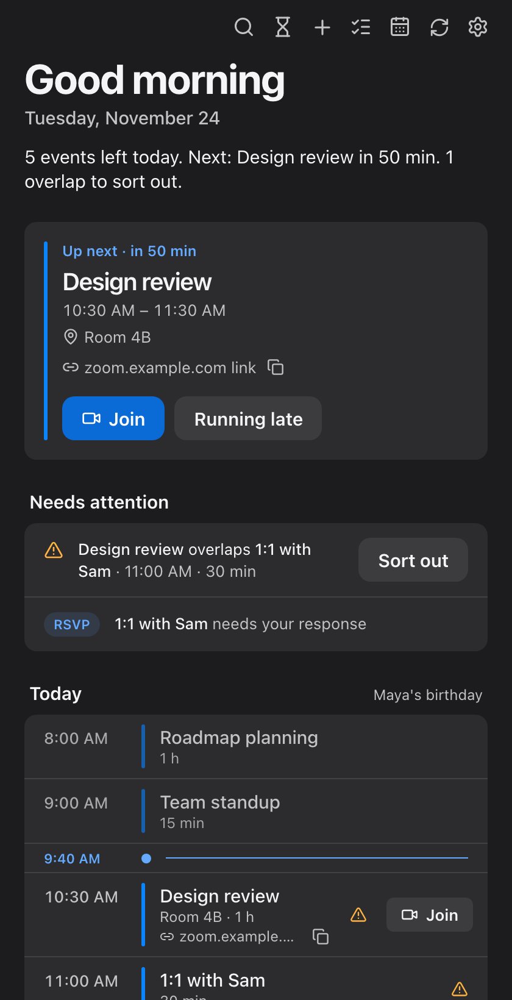
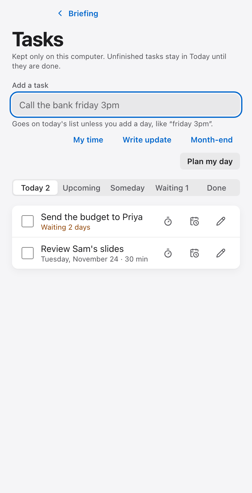
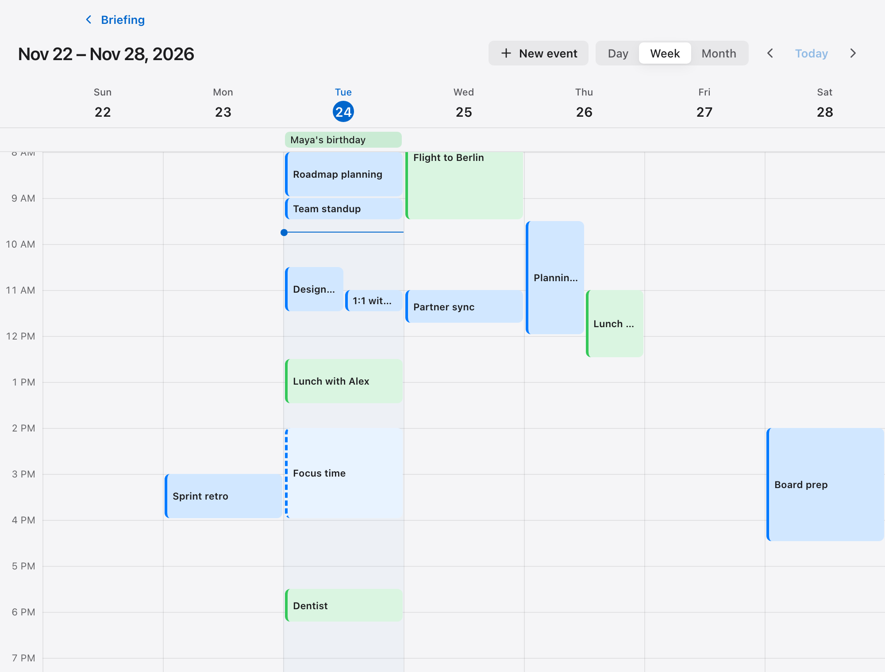

# Firstlight

**Your workday, ready when you unlock.** Firstlight is a calm desktop app for Mac and Windows that shows your day the
moment you sit down: every calendar in one place, what's next, what clashes, what's waiting on you, and when you're
free. **Private by design:** no server, no account, no analytics. Everything stays on your computer.

<p align="center">
  
  
  
</p>

## Why Firstlight

- **It shows up by itself.** The first time you unlock your computer each day, your briefing is there. Later it stays
  out of the way, and only nudges you when a meeting is about to start.
- **All your calendars, once.** Google, Microsoft 365 and Outlook.com, iCloud, Yahoo, any CalDAV server or calendar
  link, the Mac's Calendar app, and classic Outlook on Windows. The same meeting in two calendars shows once.
- **Private.** Your data is kept in an encrypted database on your computer, with the key in your system keychain.
  Firstlight talks only to the services you connect. Every feature that sends anything is off until you turn it on.
- **Works with locked-down work PCs.** It reads classic Outlook and the Mac's Calendar app directly, with no sign-in,
  so it works where IT blocks outside apps.
- **Mac and Windows alike**, and it can keep your tasks and notes in step between them.

## What it does

**Your day**
- Morning briefing: up next with a Join button, clashes and back-to-back runs, unanswered invitations, free time.
- Day, week and month views; search across your calendar (Ctrl/Cmd+K); other time zones beside your own.
- Meeting heads-ups, a morning and evening summary, and a preview of the week ahead on Sundays.
- Meeting prep (what happened last time, what's around it), private meeting notes, follow-up reminders.
- Help with clashes: which meeting to move, free times that work, and a note to the organiser.
- Find a time, focus time, a lunch check, travel time to in-person meetings, and a wrap-up at the end of the day.

**Tasks**
- A to-do list in the briefing: quick add ("call the bank friday 3pm"), repeating tasks, tasks waiting on someone with
  a nudge, a focus timer, and turning an email into a task.
- Plan my day: puts your tasks into today's free time.
- Keep tasks in step with Google Tasks, Microsoft To Do or Apple Reminders.
- Quick capture from any app with a keyboard shortcut.

**Work**
- Standup and weekly update writer, "where my time went" with a spreadsheet export.
- Time off and holidays, with meetings on your days off pointed out, and an optional automatic out-of-office reply.
- Do Not Disturb during meetings on a Mac (with two shortcuts you make once).

**Optional extras** (all off until you turn them on)
- An email digest: unread count, invitations and mail from people who matter (Mail app, Gmail, Microsoft, Yahoo,
  iCloud, Outlook on Windows).
- AI: a smarter summary of your day, questions about your calendar, and help planning, with the AI service and key you
  choose. You see the exact text that would be sent before you agree.
- Sharing between your computers through a folder you already sync (iCloud Drive, OneDrive, Dropbox, Google Drive),
  encrypted with a code only your computers have.

**Looks**
- Follows your system's light or dark mode, or choose one of 13 themes, 14 fonts, four text sizes and your accent colour.

<p align="center">
  
</p>

## Download

Get the latest version from the [Releases](../../releases) page:

- **Windows 10 or 11:** `Firstlight_…_x64-setup.exe`. Installs for your user account; no administrator needed.
- **Mac (macOS 13 or later, Apple chips and Intel):** `Firstlight_…_universal.dmg`. Open it and drag Firstlight to
  Applications.

Early versions may not be signed yet. On Windows, if SmartScreen says "Windows protected your PC", choose **More info**,
then **Run anyway**. On a Mac, the first time, right-click Firstlight in Applications and choose **Open**.

Then add a calendar, or try it with sample data first.

## Privacy

Firstlight has no server and collects nothing. In short:

- Your events, tasks and notes stay on your computer, encrypted.
- Passwords, sign-ins and keys are kept in your system keychain.
- It connects only to the calendar, mail, task, AI and storage services you choose.
- Nothing is ever sent to the people who make Firstlight.

Read the full [privacy policy](docs/PRIVACY.md); it's also in the app under Settings, About.

## Build it yourself

You need [Node.js](https://nodejs.org) 22 or later and [Rust](https://rustup.rs) (stable).

```sh
npm install
npm run tauri dev        # run the app
npm run tauri build      # make an installer for this computer
```

Google and Microsoft sign-in need an app registration. Either put the IDs in `.env` before building, or paste them
into the app afterwards (Accounts, "Your own Google or Microsoft sign-in app"). See
[docs/OAUTH_SETUP.md](docs/OAUTH_SETUP.md).

Checks:

```sh
npm run check            # types, lint, unit tests
npm run e2e              # browser tests
cargo fmt --check && cargo clippy --workspace --all-targets -- -D warnings && cargo test --workspace
```

How the project is laid out:

- `crates/logic`: the pure rules (briefing, calendar parsing, tasks, conflicts). No files or network; it also builds
  to WebAssembly.
- `crates/core`: storage, providers, mail and sync. No user interface code.
- `src-tauri`: the desktop shell (windows, tray, notifications, system integration).
- `src`: the interface (React and TypeScript).

## Documentation

- [Privacy policy](docs/PRIVACY.md) and [terms of use](docs/TERMS.md)
- [Connecting Google and Microsoft](docs/OAUTH_SETUP.md)
- [Launch plan](docs/LAUNCH.md), [releasing](docs/RELEASE.md) and [security review](docs/SECURITY_REVIEW.md)
- [Security model](SECURITY.md)

## Feedback and problems

Please open an [issue](../../issues). In the app, **Settings, About, Report a problem** makes a report you can attach;
it contains no calendar, email or account content.

## Licence

The licence for this code hasn't been chosen yet; until a `LICENSE` file is added, all rights are reserved. Using the
app is covered by the [terms of use](docs/TERMS.md).
